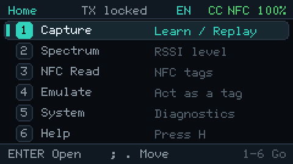
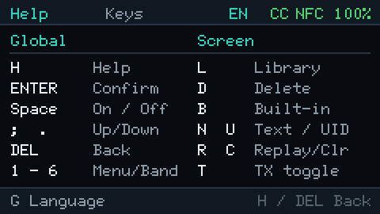

# CAP LAB — Sub-GHz & NFC lab firmware for Cardputer ADV

[中文详细文档（开发笔记、实现细节）](firmware/README.md) ｜ [发布包下载](release/README.md) ｜ [Cap CC1101 接入指南](docs/CC1101接入指南.md)

Custom firmware for the **M5Stack Cardputer ADV** with the **Cap CC1101 & NFC (U219)** —
sub-GHz remote capture/replay and NFC tag reading/cloning/emulation, with a
bilingual (Chinese / English) on-device UI.

> Why custom firmware? The stock Bruce launcher does not initialise this cap:
> its `POWER_EN` and `RF_SW` pins are left floating, so neither radio ever gets
> power. CapLab drives both chips from scratch (CC1101 registers borrowed from
> the Flipper ZeroOOK 270 kHz async preset; ST25R3916 via its own HAL).

| Menu (EN) | Help (EN) |
|---|---|
|  |  |

## Features

- **Sub-GHz capture & replay** — 315 / 433 / 868 / 915 MHz, raw edge capture,
  PWM (EV1527-style) decode, RMT-precise replay, 32-channel RSSI spectrum sweep.
- **NFC read / clone / emulate** — NFC-A (ISO14443A), NDEF extraction, full-dump
  cloning of Type 2 tags (NTAG213/215/216, Ultralight) into an 8-slot library
  persisted in NVS. Card emulation replays a cloned tag with its **real UID**;
  verified with a phone reading an NDEF URL.
- **Always-on capture mode** — hold a tag near the reader and it is cloned
  automatically: one handshake per read (`clonePoll()`), no timeout, no spurious
  "no card".
- **Bilingual UI** — press `G` in any screen to switch Chinese / English;
  stored in NVS. All 155 UI strings live in a single X-macro table (`i18n.h`).
- **Help key** — `H` from any screen opens a full key reference and returns
  where you were.
- **Safe diagnostics** — self-test synthesises a frame and decodes it without
  touching the radio state; TX is locked by default and must be armed on the
  Info screen.

MIFARE Classic cloning is **not** supported (no Crypto1 implementation).

## Hardware required

- M5Stack Cardputer ADV
- Cap CC1101 & NFC (U219) plugged into the EXT port

## Install

| Method | File | Steps |
|---|---|---|
| M5Launcher / SD card | `release/CapLab-1.5.1-app.bin` | Copy to a FAT32 SD card → M5Launcher → `SD` → select → `Install` |
| esptool | `release/CapLab-1.5.1-app.bin` | `esptool.py --chip esp32s3 -p COM7 write_flash 0x10000 CapLab-1.5.1-app.bin` |
| M5Burner (flash from 0x0) | `release/CapLab-1.5.1-full.bin` | Merged image: bootloader + partitions + otadata + app |

Keys: `G` language ｜ `H` help ｜ `ENTER` confirm / primary action ｜ `SPACE` start-stop ｜ `;` `.` move ｜ `DEL` back ｜ `1-6` menu shortcuts.

## Build from source

```bash
cd firmware
python -m platformio run            # esptool flash: python -m platformio run -t upload
```

Arduino framework + M5GFX/M5Unified. No RadioLib (packet-mode drivers can't
give you raw demodulated waveforms). Requires PlatformIO; the project pins its
build dir to `%TEMP%/caplab-pio-build` to dodge a linker bug with non-ASCII
project paths on Windows.

## Repository layout

```
firmware/   firmware source (PlatformIO), detailed Chinese dev docs
release/    versioned binaries, cover art, M5Burner listing material
tools/      host-side serial scripts (screenshot / key injection / clone polling)
docs/       Cap CC1101 hardware guide (Chinese)
```

## License & disclaimer

MIT — see [LICENSE](LICENSE).

For authorised testing and **your own** cards / remotes only. Replaying
sub-GHz transmissions may be regulated in your region; fit an antenna and
transmit only where permitted.
