# caprf — Cardputer-Adv + Cap CC1101 一体固件

给 **M5Stack Cardputer-Adv** + **Cap CC1101 (U219)** 写的 Sub-GHz 学习/重放/频谱 + NFC 读卡 / 卡模拟固件。

Bruce 认不出这块卡（缺 POWER_EN 和 RF_SW 的配置项），所以从驱动到 UI 全部自己写。

| | |
|---|---|
| 目标板 | Cardputer-Adv（ESP32-S3FN8，8MB flash，**无 PSRAM**） |
| 工具链 | PlatformIO 6.2.0 / espressif32 6.10.0 / M5Cardputer 1.1.1 |
| 版本 | v1.5.1 |
| 体积 | Flash 1,249,152 B（39.7%） / RAM 59,888 B（18.3%） |

---

## 实测状态

下面每一条都在真机上跑过，不是"编译通过"。

| 项目 | 结果 |
|---|---|
| 芯片初始化 | `cc=1 ver=0x14 nfc=1` —— CC1101 与 ST25R3916 都上了电 |
| NFC 芯片身份 | `id=5/2 idok=1` —— 读到 ST25R3916 的 IC 型号码，SPI 链路真的通 |
| **NFC 卡模拟** | **手机贴上去成功读到 `https://m5stack.com`，NDEF 完整取出** |
| **真卡克隆** | 读 NTAG 215 全片 504 B → 存 NVS → 重启自动恢复 → 模拟时 UID 换成真卡的 `04:9F:54:AD:89:26:81` |
| **自检不毁存档** | 有真卡存档时跑 `clone test`，输出 `restored=1 type=NTAG 215`，自检后 `clone stat` 仍是 504 B 真卡 |
| 克隆跨重启 | esptool 硬复位后 `clone stat` 直接 `active=1`，不需要手动 `clone load` |
| **卡库** | 4 张卡（1 真 + 3 合成）列表显示、切换、删除全过；硬复位后仍在；`clone test` 后 `lib=1` 未被污染 |
| **删除持久化** | 造 3 张 → 全删 → 硬复位 → `LIB n=0`，旧 `tag` 键不再把卡读回来 |
| **读卡稳定性** | 去掉自动 ISO15693 探测后单次 `scan` 约 0.08 s；25 次连续扫描、NFC 屏自动轮询 25 s 均无失灵 |
| **全中文界面** | M5GFX `fonts::efontCN_12` 字库，状态 / 提示 / toast / 菜单全汉化；菜单 6 项含「操作帮助」；九张界面截图逐张核对无截断 |
| **H 一键帮助** | 菜单按 `H` → 帮助屏(6) → 再按 `H` 回菜单(0)；读卡屏按 `H` → 帮助屏 → `DEL` 原路回读卡屏(3)，卡库 `LIB n=1` 保留 |
| **中英双语** | 任意界面按 `G` 切换 中文 / English，语言写 NVS 跨重启保留；状态栏 `中` / `EN` 徽标；155 条文案集中在 `i18n.h` 双语表；中英 12 张截图逐张核对 |
| **常驻收录** | 读卡屏 `ENTER` 进等卡态，26 s 后仍显示「已找 160 次」不超时；`clonePoll()` 选卡+读全片一次握手，不再二次激活 |
| 解码器自检 | `n=100 T=300 text=123456 ok=1 rep=2 kind=PWM24`，与构造值完全一致 |
| 采集闭环 | 主机翻转 GDO0 → 中断采 98 段 → 解出 `123456`，`T=304` |
| RMT 重放时序 | 76.8ms 波形实际耗时 76,974µs（误差 0.23%），确认不是空转 |
| 重放权限 | TX 未解锁时 `ERR replay TX 已锁定`；解锁后 `OK replay` |
| 频谱扫描 | 32 通道逐点进 RX 采样，`state=0x0D`，读数 -108 ~ -113 dBm 各不相同 |
| NFC 读卡 | 无卡时 `present=0` 且不崩溃，状态条 `NFC` 常亮 |
| 六屏 UI | 全部截图逐张核对，无重叠/无截断/无错位（见 `docs/`） |

---

## 界面

七个屏，**中英双语**（任意界面按 `G` 切换，默认中文），任意界面按 `H` 一键帮助（再按 `H` 或 `DEL` 原路返回），`1-6` 直选（第 6 项是「操作帮助」），`;` `.` 上下移动，`ENTER` 进入 / 执行主操作，`DEL` 返回。技术数值（UID、ATQA、dBm、芯片型号）保留通用写法。

| 菜单 | 采集 |
|---|---|
| 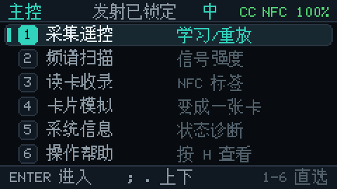 | 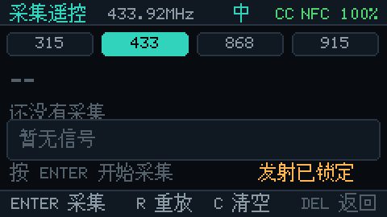 |

| 采到信号 | 频谱 |
|---|---|
| 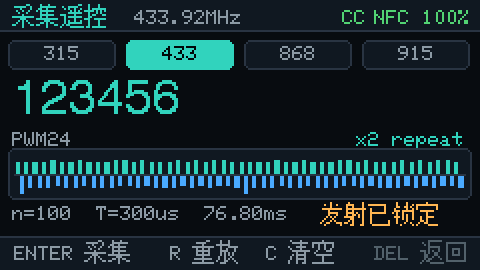 | 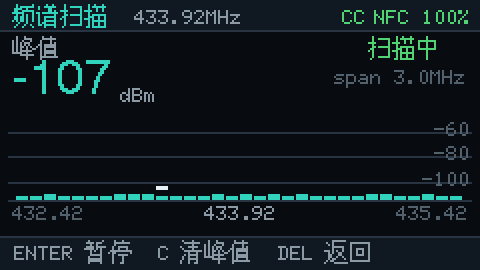 |

| NFC 读卡 | NFC 模拟 |
|---|---|
| 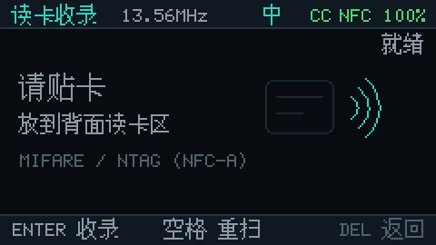 | 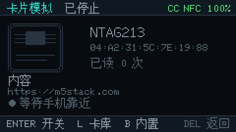 |

| 诊断 | 操作帮助 |
|---|---|
| 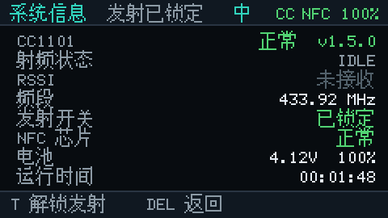 | 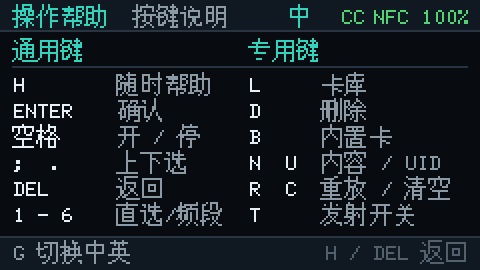 |

| 收录等卡 | 卡库列表 |
|---|---|
| 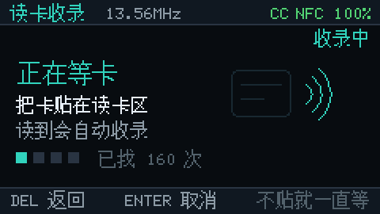 | 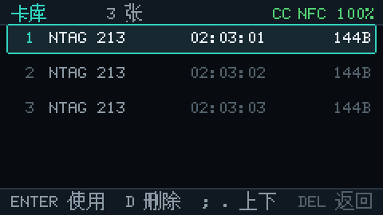 |

英文界面（按 `G` 切换后的效果）：

| Menu (EN) | Help (EN) |
|---|---|
| 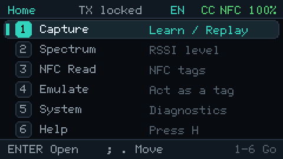 | 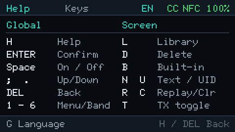 |

设计上刻意保持的几条：

- 全部**离屏画布渲染后一次推屏**，切屏和刷新都不闪。
- 状态栏右侧两颗独立指示灯 `CC` / `NFC`，绿=好、红=坏、灰=没上线。
- 波形区按**对数刻度**画，短脉冲不会缩成一条线；高电平青色、低电平蓝色。
- 采集是全自动的：静音 400ms 或缓冲满就收工，不用一直按着。
- 重放默认锁定，必须在 INFO 页按 `T` 显式解锁，防止现场误发。
- 模拟运行时**用声音报告进度**——手机贴着背面时看不见屏幕，所以读卡器靠近响 1400Hz、读完响 2800Hz。

---

## 按键

全项目只有一套通用规则，剩下几个字母键都写在对应屏的底部，菜单第 6 项「操作帮助」有一屏中文对照表，任意界面按 `H` 可直接调出。

| 屏 | 键 | 作用 |
|---|---|---|
| 通用 | `G` | **中英界面切换**，语言写 NVS，跨重启保留 |
| 通用 | `H` | **任意界面一键帮助**，再按一次或 `DEL` 原路返回 |
| 通用 | `ENTER` | 确认 / 本屏主操作 |
| 通用 | `空格` | 开始 / 停止（多数屏与 `ENTER` 等价） |
| 通用 | `;` `.` | 上下选择 |
| 通用 | `DEL` | 返回上一层 |
| 菜单 | `1`-`6` | 直选：采集 / 频谱 / 读卡 / 模拟 / 信息 / **帮助** |
| 采集 | `ENTER` `R` `C` | 开始 / 停止监听、重放、清空 |
| 采集 | `1`-`4` | 切 315 / 433 / 868 / 915 MHz |
| 频谱 | `ENTER` `C` | 暂停扫描 / 清峰值 |
| 读卡 | `ENTER` | **收录**：进常驻等卡态，贴上去自动读全片存进卡库；再按一次取消（`K` 仍兼容） |
| 读卡 | `空格` `D` | 重新寻卡 / 读 NDEF |
| 模拟 | `ENTER` | 开始 / 停止模拟（退出屏自动停） |
| 模拟 | `L` | 打开 / 关闭卡库列表 |
| 模拟 | `N` `U` | 换 NDEF 内容 / 换新 UID（仅内置模式） |
| 模拟 | `B` | 回到内置卡（存档保留） |
| 卡库 | `;` `.` | 上下选择 |
| 卡库 | `ENTER` `D` | 用这张卡模拟 / 从库里删掉 |
| 信息 | `T` | 解锁 / 锁定发射 |

---

## 串口调试协议

USB CDC，115200。之所以做这套东西：**没有屏幕截图就没法验证 UI**，所以固件内置了 RLE 编码的帧回传。

```bash
help                                       # 命令列表
stat                                       # 状态快照
ui <menu|capture|scan|nfc|emu|info|help>   # 切屏
band <315|433|868|915>
learn / stop / clear / replay
tx <on|off>                                # 发射授权
nfc [def|v]                                # 寻卡 / 读 NDEF / 手动扫 ISO15693
emu [on|off|stat|dump]                     # 卡模拟：开关 / 状态 / 回读寄存器
emu text <字符串>                          # 改 NDEF 内容
emu uid <hex> | emu rnd                    # 指定 / 随机生成 UID
clone [run|off|list|use <n>|del <n>|stat|test]   # 收录 / 列表 / 切换 / 删除 / 自检
clone bak | clone unbak                    # 单卡快照 / 还原（破坏性操作前兜底）
clone fake                                 # 调试：造 3 张合成卡验证列表
snap                                       # 回传屏幕：RLE + base64
selftest / demo / loop / scan              # 三个自检 + 频谱原始值
save / load / key <c|g|h|enter|space|del>    # 模拟按键，脚本能走完整套 UI（含切语言、一键帮助）
lang [zh|en]                                 # 查询 / 切换界面语言，写 NVS
```

`emu dump` 会回读 `NFCIP-1 Passive Target Definition` 与 Mode Definition 寄存器，这是**单机条件下**能拿到的最硬证据：

```
EMUDUMP running=1 state=waiting for reader md=0xC8 ptd=0x5C ptm=0x5F hits=0 frames=0
  target=yes (PICC)  d_106_ac_a=0 (software answer, normal while waiting)
```

`md` 的 bit7 是 target 位。注意 `ptd` 的 bit0 在等待阶段是 **0 而不是 1** —— 这不是 bug：Off/Idle 下由固件软件应答 WUPA，进了 Active 才置位交给硬件自动应答。库源码里那句注释写反了。

`stat` 输出示例：

```
STAT fw=1.5.1 screen=4 band=433 tx=0 cc=1 ver=0x14 marc=0x0D rssi=-111 nfc=1 nfcid=5/2 batt=100% 4.14V
CAP n=100 armed=0 ok=1 text=123456 kind=PWM24 T=300 rep=2 min=300 max=9300 total=76800
DBG up=5s key=[-] dis=0 raw=678774 arm=2533ms
```

`tools/dev.py` 是配套的主机端脚本（只需 pyserial）：

```bash
python tools/dev.py boot                          # 抓启动日志
python tools/dev.py shot scan shot/scan.png       # 切屏 + 截图（同一条连接，不复位）
python tools/dev.py seq "demo" "tx on" "replay"   # 连发命令
python tools/dev.py cmd "stat"
```

⚠️ 以前打开串口会让板子复位，因为 pyserial 在 `open()` 里默认把 DTR/RTS 拉高，ESP32 的自动复位电路（DTR→GPIO0 / RTS→EN）立刻重启芯片，克隆/模拟的现场全丢。现在 `open_port()` 在 `open()` **之前**就把 `_dtr_state` / `_rts_state` 置成 False（未打开时 `dtr` setter 会抛 `PortNotOpenError`，只能改内部字段），实测端口反复开关不再出现 boot log，状态能跨连接保留。另外固件也做了兜底：`cloneRestore()` 会在开机时自动从 NVS 恢复克隆卡。

---

## 编译与烧录

```bash
cd firmware
python -m platformio run -j 1                              # 注意：本机 pio 不在 PATH
python -m platformio run -t upload --upload-port COM7
```

`-j 1` 不是笔误：这台机器的 scons 并行清理会触发沙箱的删除次数限制，多路并行还会死锁。

`platformio.ini` 里已固化 `build_dir = ${sysenv.TEMP}/caplab-pio-build`：项目路径含中文时 `ld.exe` 创建 `firmware.map` 会失败（Windows 工具链的非 ASCII 路径问题），把构建目录指到纯 ASCII 的临时路径即可。产物在 `%TEMP%\caplab-pio-build\cardputer-adv\`，不在项目 `.pio/` 下。

**进下载模式**：侧面开关 OFF → 按住 G0 → 插 USB-C → 松开 G0。
正常烧录其实不用手动进，`upload` 会自动用 RTS 复位。

---

## 硬件前提

1. **Cap 已插好**，两颗 M2×4mm 螺丝固定。别用更长的，会顶穿内部 PCB。
2. **天线一定要拧上**。空载时 CC1101 前端自激，见下文"无天线"一节。
3. **不要热插拔**。换天线、重插卡一律先关机。
4. 频段和天线要对：315 用 315 那根，868/915 都用 868 那根。

---

## 代码结构

```
firmware/
├── platformio.ini
├── docs/                  # UI 截图
└── src/
    ├── cfg.h              # 配色 / 布局常量
    ├── i18n.h  i18n.cpp   # 中英双语字符串表（X-macro），全部界面文案唯一来源
    ├── ui.h  ui.cpp       # 离屏画布、状态栏、面板、toast、帧回传
    ├── cc1101_cap.h/.cpp  # SPI、频段切换、异步 OOK 收发、RSSI
    ├── capture.h/.cpp     # 边沿采集、PWM 解码、RMT 重放、NVS、自检
    ├── nfc_reader.h/.cpp  # ST25R3916：寻卡 / NDEF / NTAG 卡模拟 / 真卡克隆
    └── main.cpp           # 七屏状态机 + 按键 + 串口协议
```

没有用 RadioLib：它是 packet 模式驱动，抓遥控器要的是**原始解调波形**。寄存器配置直接取自 Flipper Zero 生产固件的 `subghz_device_cc1101_preset_ook_270khz_async_regs`。

---

## 五个关键实现点

### 1. POWER_EN 不拉高，整卡没电

```cpp
pinMode(CAP_PIN_POWER_EN, OUTPUT);   // G3
digitalWrite(CAP_PIN_POWER_EN, HIGH);
delay(120);                          // 等 DC-DC 稳定
```

在 `begin()` 最前面，SPI 任何操作之前。少了它读 VERSION 拿到 0x00 或 0xFF，很容易误判成接线错误。

### 2. RF_SW1 不在主机引脚上

| RF_SW0 (G13) | RF_SW1 (GDO2) | 频段 |
|---|---|---|
| 0 | 0 | 315 |
| 0 | 1 | 433 |
| 1 | 1 | 868 / 915 |

RF_SW0 是普通 GPIO。RF_SW1 接的是 CC1101 自己的 GDO2，只能写 IOCFG2 把它设成静态电平：

```cpp
writeReg(CC_IOCFG2, sw1 ? 0x2F : 0x2E);   // 0x2E=常低, 0x2F=常高
```

全固件最容易漏的一行。漏了的表现：能初始化、能读版本、就是收不到任何信号。

### 3. 异步模式下 GDO0 是双向的

- 接收：CC1101 把解调后的原始数据流推到 GDO0（`IOCFG0 = 0x0D`）
- 发送：GDO0 变成输入，由主机按记录的时序翻转电平

所以 `enterOokRx()` / `enterOokTx()` 要成对切换，重放完必须切回去。

### 4. RMT 发送只能用通道 0-3

ESP32-S3 的 Arduino 内核带的还是旧版 `driver/rmt.h`（没有 `rmt_tx.h`），而且**只有 0-3 能发**，用 4 号直接返回 `RMT CHANNEL ERR`。

```cpp
static const rmt_channel_t RMT_CH = RMT_CHANNEL_0;
rmt_config_t cfg = RMT_DEFAULT_CONFIG_TX((gpio_num_t)CAP_PIN_GDO0, RMT_CH);
cfg.clk_div = 80;   // 1 tick = 1us
```

### 5. IDLE 状态下 RSSI 寄存器是无效值

频谱最初写成"改频 → `CC_SCAL` → 读 RSSI"，结果整屏恒定显示同一个假读数。原因：`SCAL` 是 IDLE 下的动作，芯片留在 IDLE 时 RSSI 不是有效测量值。

正确做法是真正进 RX 再读：

```cpp
rf.idle();
rf.setFrequencyMHz(f);
rf.strobe(CC_SRX);                     // MCSM0=0x18，IDLE->RX 会自动校准
while (rf.marcState() != 0x0D && timeout) {}   // 等校准结束
int8_t v = rf.rssi();
```

---

## 卡模拟（NTAG 系列）

选 NTAG 而不是 MIFARE Classic，原因是后者需要 Crypto1 认证，库只做到防冲突层，物理上做不出来。NTAG 是 Type 2 Tag，手机会当成普通的 NDEF 标签去读，能存网址、文本、名片。

内置 NDEF 模式默认用 **NTAG213**，内存 45 字节，手工拼：

```
page 0-1   UID(7) + BCC0/BCC1 + Internal(0x48) + Lock0/Lock1
page 3     Capability Container：E1 10 12 00        (0x12 = 144 B)
page 4 起  NDEF TLV：03 <len> D1 01 <len> 'U' <前缀> <URL> FE
```

容量跟着类型走，不再写死。CC 字节的映射：

| 类型 | 用户区 | CC 第 3 字节 |
|---|---|---|
| Ultralight / 210 | 48 B | `0x06` |
| NTAG213 | 144 B | `0x12` |
| NTAG215 | 504 B | `0x3E` |
| NTAG216 | 888 B | `0x6D` |

三个容易写错的地方：

**BCC0 必须带 CT 位。** `BCC0 = 0x88 ^ UID[0..2]`，那个 `0x88` 是级联标记（CT），不是填充值。漏了它读卡器算校验和就和不上，直接不进 SELECT。

**Lock 字节必须全 0。** 只要 Lock0/Lock1 有任意一位被置上，读卡器就会认为对应页只读 —— 手机能读但不会写，某些 App 还会直接报"标签已锁定"。

**UID 长度决定页布局。** 7 字节 UID 走级联，page 0 放 UID0-2 + BCC0，page 1 放 CT + UID3-6 + BCC1；4 字节 UID 的 BCC0 算的是另外三个字节。混着写读卡器直接不认卡。

状态机的三个阶段对应芯片的不同行为：

| 状态 | 屏幕上 | 实际发生什么 |
|---|---|---|
| `waiting for reader` | 灰点 | 等外部 RF 场，靠 `I_eon32` 中断唤醒 |
| `reader found` | 黄点 | 场起来了，给 WUPA 回 ATQA |
| `reading` | 绿点 | 被选中，开始按 block 吐数据 |

`reads` 计的是**被贴了几次（会话数）**，不是收到的帧数。这点容易搞错：手机读一张 NTAG213 要连发十几帧（WUPA → SELECT CL1 → SELECT CL2 → RATS → READ×N），如果逐帧计数，贴一下就会跳到十几，看着像 bug。

判定会话的方式是状态跃迁——从「没有场」进到任何活动状态才算一次。手机在同一场里反复轮询不会重复计数，因为它一直没回到 Off。配合 `setExpiredTime(2000)`：手拿开 2 秒后回 Off，下次再贴才算新的一次。串口 `emu stat` 会同时给出 `hits` 和 `frames`，两个一起看才好判断。

这里有个反直觉的点：**等待阶段 `ptd` 寄存器的 bit0 是 0**。看 `configure_emulation_a()` 会以为写错了，其实 Off/Idle 下是固件软件应答 WUPA，进了 Active 才置位交给硬件自动应答。库源码那句注释是反的，别当 bug 去改。

关掉模拟时卡图标变暗、波纹消失，提示也换成「ENTER 开关」：

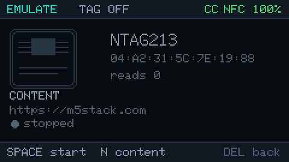

---

## 克隆真卡

把一张真标签贴在设备上读一遍，之后就能原样"冒充"它，不用再带原卡。

```bash
clone          # 读手上这张卡 → 存 NVS → 下次 ENTER 模拟它
clone run      # 读完立刻开始模拟
clone load     # 从 NVS 取回上次存的
clone off      # 回到内置 NDEF（存档保留，load 还能拿回来）
clone stat     # 当前状态 + 用户区前 64 字节
clone test     # 合成卡自检：apply → 拼内存 → NVS 往返 → 起模拟
```

**原理是整片搬运，不是解析 NDEF。** Type 2 Tag 的存储是扁平页，`NFCLayerA::read()` 不需要任何认证就能从 page 4 一直读到底，所以克隆只是把原始字节数组存下来，模拟时再原样铺回内存。这样连厂商自定义数据区、OTP 之外的私有内容也能一起带过来 —— 解析成 NDEF 再重新生成反而会丢东西。

实测那张卡是 **NTAG 215**，UID `04:9F:54:AD:89:26:81`，504 字节，头部 `03 10 D1 01 0C 55 02 6D 35 73 74 61 63 6B 2E 63 6F 6D FE`：

```
03        NDEF Message TLV
10        length = 16
D1 01 0C  MB|ME|SR|TNF=well-known, type len 1, payload len 12
55        'U' —— URI 记录
02        前缀码 2 = https://www.
6D 35 ... "m5stack.com"
FE        Terminator TLV
```

也就是一张 M5Stack 官方的 `https://www.m5stack.com` 卡。

**收录是常驻模式，既不报 `no card` 也不超时。** 这条链路踩了三层坑：

1. 最早在按键回调里同步死等读卡，屏幕冻着，手还没放稳就报 `no card`。
2. 改成非阻塞等待后，流程是 `scanA()` 先激活一次再去激活，紧接着 `cloneRead()` 又重新 `activate()` 最多 6 次 —— **等于要求同一张卡连续握手成功两次**。场重新起振、手一抖、位置略偏，第二次就全落空，于是"明明贴着卡却报 `no card`"。
3. 现在 `clonePoll()` 把「选卡 + 读全片」合成**一次握手**：`activate()` 成功后直接在同一个激活态里 `read()` 全部用户页，不再去激活重来。

```
读卡屏按 ENTER  →  屏幕显示「正在等卡 / 把卡贴在读卡区」
              →  主循环每 180 ms 调一次 clonePoll()
              →  读不到 = 正常中间态，不提示、不退出，继续找
              →  读到就自动存库、设为当前卡、蜂鸣，退出等卡态
              →  只有 MIFARE Classic / 类型不支持 / 读取失败才说清原因并收工
              →  没有超时；DEL 返回、ENTER 或空格取消
```

屏幕上同时显示「已找 N 次」和流动的小方块，让人知道固件没卡死。实测等 26 秒仍是「已找 160 次」，`stat` 正常响应；每 60 次落空会 `recover()` 重初始化一次芯片。串口 `clone` 走的仍是 `cloneRead()`（内部循环调 `clonePoll`），无卡时约 1.5 秒返回 `no card`，行为不变。

`clonePoll()` / `cloneRead()` 都会先 `ensurePollMode()` 确认芯片真的在 NFC-A 读卡模式 —— 刚从模拟态切回来时寄存器刚重写、场还没起振，头几次 `detect` 失败是正常的。收录成功后走 `cloneSave()`（`libAdd` + 把新卡设为 `cur` + 写 NVS），所以卡库里会出现 `*` 标记，开机也会自动恢复；直接 `libAdd` 会漏掉这一步。

**重启不会丢，删掉也不会自己回来。** 卡库存在 NVS 的 `caplab` 命名空间：`cnt` 是张数，`cur` 是当前选中索引（-1 = 内置 NDEF），`c0..c7` 每槽一个 blob。开机 `cloneRestore()` 先 `libLoad()`，`cur >= 0` 就自动套用，所以拔插 USB、按 RESET 之后直接 ENTER 就能继续冒充；执行过 `clone off` 的不会被自动恢复。

这里踩过一个很隐蔽的坑：1.2.x 时代的单卡键 `tag` 从来没被删过，而早期的 `libLoad()` 在库为空时会把它当"还没迁移"重新读回来 —— 结果就是**删光卡、重启，卡又回来了**。现在 `libPersist()` 无条件 `remove("tag")`，迁移只在 `cnt` 键不存在（真正没用过卡库的老固件）时发生，且迁完立刻删。实测造 3 张 → 全删 → 硬复位 → `LIB n=0`。

**Classic 克隆不了。** `begin()` 阶段就被库拒绝 —— 没有 Crypto1，连认证都过不去，谈不上读扇区。

**`clone stat` 只打前 64 字节。** 一次把 504 字节 hex 全打出来，如果主机没在读，USB CDC 缓冲会被灌满，固件卡死在下一次 `Serial.write` 里 —— 屏幕冻结、按键无响应，只能按 RESET。所以超过 64 字节就截断，末尾标 `...(+440)`。

**克隆模式下 `N` / `U` 不生效。** 内容和 UID 都跟着真卡走，改内置 NDEF 没有意义。界面会弹「克隆模式下请按 B 回内置卡」，串口回 `ERR emu text: clone mode (...)`，不会静默吞掉。想用内置 NDEF 就先 `clone off`。

**`clone off` 会把 UID 一起复位。** 只清标志位是不够的 —— `s_uid` 还挂着真卡那个，退回内置 NDEF 就成了一张「真卡 UID + 内置内容」的怪卡。现在 `cloneDisable()` 把 UID、类型、内存全复位到内置 NTAG213。

**自检不碰你的存档。** `clone test` 内部要写 NVS，所以开头把整个卡库快照下来，跑完再写回并重建内存，末尾打一行 `restored=1 lib=1 cur=0 type=NTAG 215` 让你确认保住了。

---

## 读卡稳定性（v1.3.1）

**自动轮询里的 ISO15693 探测是失灵之源。** `scan()` 以前在 NFC-A 没应答时顺手 `s_layer_v.detect()` 一次，但工程从头到尾没调用过 `configureNFCMode(NFC::V)` —— 芯片还在按 A 的调制发帧，V 卡根本不应答，反而把射频状态弄乱。改成显式切到 V、用完切回 A 之后，实测仍会周期性让某次扫描卡住 4 秒以上：一来一回要写两遍寄存器、等两次场起振，节流到每 5 秒一次也躲不掉（25 次扫描里抓到 2 次 4 秒超时）。

本项目实际用的是 NTAG21x / MIFARE，都是 NFC-A。所以 1.3.1 把自动 V 探测整个去掉，`scan()` 现在就是 `scanA()`，单次约 0.08 秒。真要读 15693 标签，用串口 `nfc v` 手动触发 `scanV()`（同样会切模式再切回，但只在用户明确要求时做一次）。

**芯片卡死不用再按 RESET。** `recover()` 直接重跑 `s_unit.begin()`，它内部会 `CMD_STOP_ALL_ACTIVITIES` → `CMD_SET_DEFAULT` → 重新起振，正好能解掉"帧发不出去"的中间态；`begin()` 本身幂等，重跑安全。NFC 屏连续 8 次扫空就自动调一次。

**模式切换的收尾动作补齐了。** `emuStop()` 以前只改配置、不停 layer、不等场起振，紧接着的 `detect` 常常白跑。现在三步都做：`s_layer` / `s_layer_v` 去激活 → 写 `emulation=false` 并 `configureNFCMode(A)` → `delay(12)` 等场重新建立。

---

## 卡库（v1.3.0）

一开始只存"上一次克隆的那张"，用过一次就知道不够：换张卡就得把旧的顶掉。现在改成卡库。

**8 个槽位**，按 UID 去重 —— 同一张卡再收一次只刷新内容，不占新位。每张约 912 字节（用户区 888 B 占大头），8 张 ≈ 7.3 KB，NVS 分区 24 KB 装得下。

进入 EMULATE 屏按 `L` 打开列表：

```
LIBRARY      TAGS        CC NFC 100%
* 1  NTAG 215    89:26:81     504B
  2  NTAG 213    02:03:01     144B
  3  NTAG 213    02:03:02     144B
  4  NTAG 213    02:03:03     144B
;. move  ENTER use        D delete
```

行首 `*` 是**当前正在模拟的那张**，反白高亮的是光标。`;` `.` 移动，`ENTER` 换过去（正在广播就自动重启一次让芯片重读内存），`D` 删除，`L` 或 `DEL` 关掉列表。

删除要注意：删掉的如果是当前这张，会退回内置 NDEF，`*` 也跟着没了。

串口侧是 `clone list` / `clone use <n>` / `clone del <n>`，序号从 1 开始，与界面一致。

**旧存档会自动迁移。** 1.2.2 及以前用的是单卡 `tag` 键，`libLoad()` 发现库里是空的、但旧键还在，就把那张搬进 `c0`，不用重新贴卡。

**存储布局**：`caplab` 命名空间下 `cnt`（张数）、`cur`（当前索引，-1 = 内置 NDEF）、`c0`..`c7`（每张一个 blob）。开机 `cloneRestore()` 先 `libLoad()`，`cur >= 0` 才自动套用。


## 无天线时的自激噪声

空载输入时 CC1101 前端会自激出约 **135kHz 方波**，实测 **27 万次边沿/秒**。真实遥控脉冲都在 100µs 以上，所以：

- 中断里丢弃 `<90µs` 的脉冲（只跟电平，不记账）；
- 连续 1.2 秒边沿极密、却一条合格脉冲都没有 → 判定为纯噪声，主动收工并提示 `noise floor - antenna?`。

没有第二条的话，静音判断永远不会成立，会一直烧 30% 的 CPU。拧上天线后噪声自然消失。

---

## 已知限制

| 限制 | 说明 |
|---|---|
| 只解 PWM | 1:3 比例编码（EV1527 / PT2262 一类）。FSK / Manchester 只显示原始统计，不出 hex |
| 卷码无能为力 | KeeLoq 这类滚动码重放一次就失效，是协议特性不是固件问题 |
| 采集深度 | 1400 段，按 4kbps 约 0.7 秒，够一帧遥控码，不够连续录音 |
| 模拟只支持 Type 2 | NTAG213/215/216、MIFARE Ultralight 这一类，能存 NDEF、手机能读 |
| 模拟不了门禁卡 | MIFARE Classic 1K/4K 要 Crypto1 认证，DESFire / CPU 卡要密钥，物理上做不到 |
| 双芯片分时 | CC1101 是 SPI mode 0，ST25R3916 是 mode 1 + 10MHz，同一组线，不能在一个循环里交替跑 |

---

## 排错

| 现象 | 原因 |
|---|---|
| `cc=0 ver=0x00` | 卡没供电（没插好 / POWER_EN 没起来） |
| `cc=0 ver=0xFF` | MISO 没通，或 CS 不对（SPI 全 0xFF 最常见原因还是 POWER_EN） |
| `cc=1` 但收不到任何信号 | RF_SW1 没配 / 天线频段不对 |
| toast `noise floor - antenna?` | 天线没拧，或输入失配 |
| toast `noise only` | 收到了东西但脉宽全 <100µs，多半是噪声或邻近频段干扰 |
| `ERR replay 没有数据` | 先采集或 `demo`，而且**必须用同一条串口连接**操作 |
| `ERR replay TX 已锁定` | 到 INFO 页按 `T` 解锁 |
| 手机贴上去没反应 | 线圈要对准 Cap 上那块方形区域；iPhone 需亮屏且不在相机里 |
| 停在 `waiting for reader` 不跳 | 场太弱，贴紧一点；确认 `TAG ON` 亮着 |
| `E ... esp_core_dump_flash: Incorrect size` | coredump 分区残留旧数据，`esptool erase_region 0x3F0000 0x10000` |

---

## 配套目录

```
tools/dev.py       主机端调试脚本（串口命令 / 截图 / 批量）
shot/              tools/dev.py 生成的截图输出目录
```
